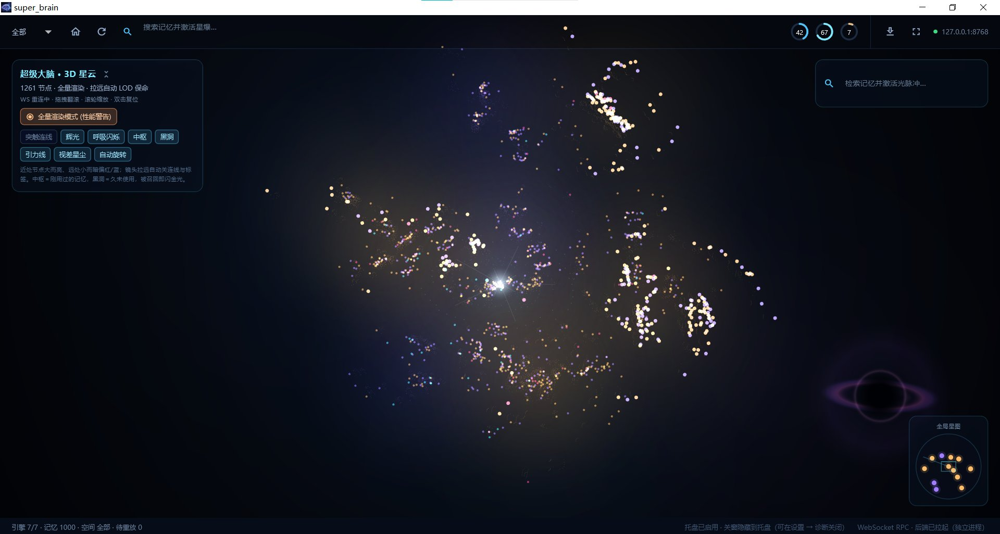
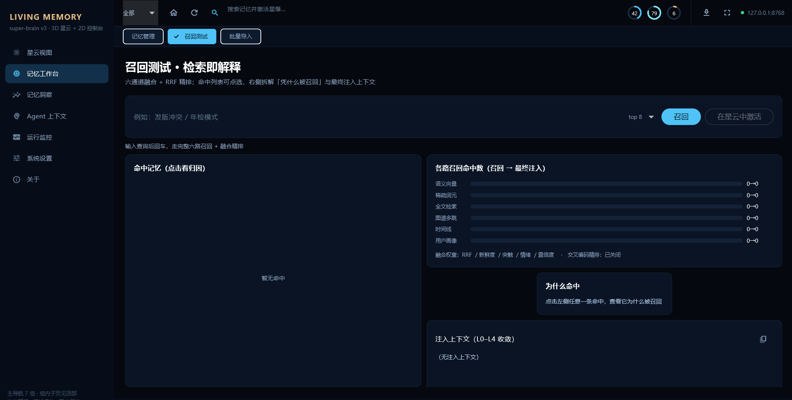
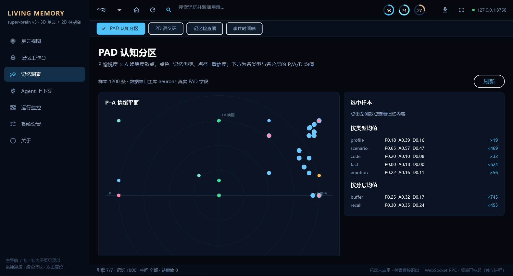
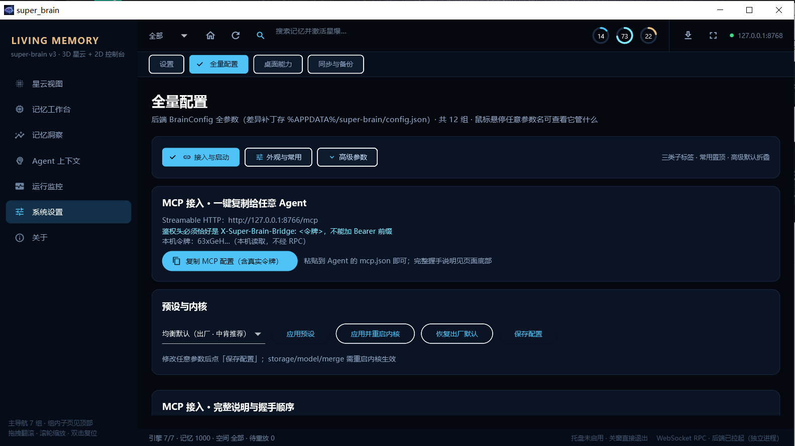
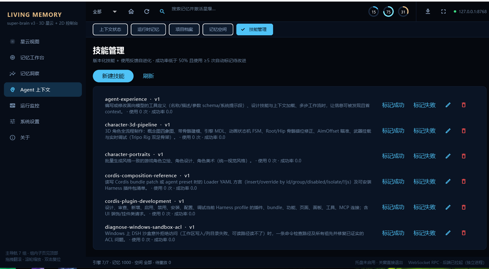
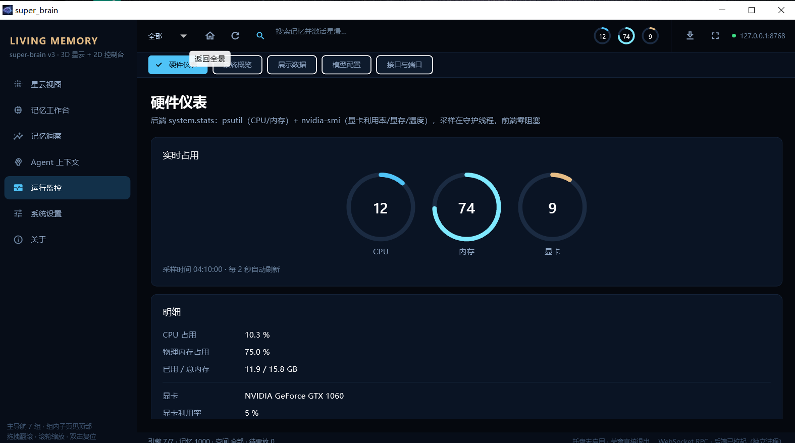

<div align="center">


# 超级大脑 · Super Brain Memory

**给你的所有 AI Agent 装一个共享的外置大脑。**

CodeBuddy / WorkBuddy / DSH / Cursor / Claude Desktop 写进去的记忆，下一秒别的 Agent 就能想起来。

[](https://www.python.org/)
[](https://flutter.dev/)
[](https://modelcontextprotocol.io/)
[](https://developer.nvidia.com/cuda-toolkit)
[](#-测试)
[](#-license)

[快速开始](#-60-秒接入你的-agent) · [功能](#-它能做什么) · [界面](#-界面) · [架构](#-架构) · [参与贡献](#-参与贡献)

</div>

---

## 🤔 为什么需要它

每个 AI Agent 都有自己的「上下文」，但你的人生只有一个。

- 你跟 CodeBuddy 说过「周五发版要双人复核」，换到 WorkBuddy 它一无所知；
- 你纠正过一条错误记忆，另一个 Agent 还在拿旧版本回答你；
- 云端记忆服务要上传隐私，本地方案又只能给单个应用用。

**超级大脑是一台跑在你自己电脑上的记忆中枢**：所有 Agent 通过 MCP 接进来，读写**同一份**记忆；
写入由「丘脑」统一准入（去重 / 分类 / 情绪标注），再由六引擎投影成可检索的结构，
最后交给本地 BGE-M3 + Qwen 做向量与语义处理。数据不出本机。

<table>
<tr><td width="50%">

**🧠 一个库，所有 Agent 共享**
不是每个 Agent 一份私有笔记。A 写的，B 立刻能召回。

</td><td width="50%">

**🔒 完全本地**
六引擎 + 三模型全在本机，断网可用，记忆不上云。

</td></tr>
<tr><td>

**🌌 看得见的记忆**
1261 条记忆铺成一片真 3D 星云：星团按语义成团、按类型着色，写入/召回会亮起光脉冲。

</td><td>

**✍️ 可纠正、可遗忘、可审计**
纠正产生新版本并保留原值；遗忘只移出推理路径，审计永远查得到。

</td></tr>
</table>

---

## 🚀 60 秒接入你的 Agent

> 前提：本机已启动超级大脑（桌面端会自动拉起后端，HTTP `8768` / WS `8767` / MCP `8766`）。
> 「系统设置 → 全量配置」页可**一键复制**下面这段 JSON（含真实令牌）。

**方式 A：Streamable HTTP（推荐，任何语言的客户端都能用）**

```json
{
  "mcpServers": {
    "super-brain-memory": {
      "type": "streamable-http",
      "url": "http://127.0.0.1:8766/mcp",
      "headers": { "X-Super-Brain-Bridge": "<你的令牌>" }
    }
  }
}
```

**方式 B：stdio（本机进程，无需令牌）**

```json
{
  "mcpServers": {
    "super-brain-memory": {
      "type": "stdio",
      "command": "C:\\Windows\\system32\\cmd.exe",
      "args": ["/c", "%LOCALAPPDATA%\\SuperBrain\\bin\\super-brain-mcp.cmd"]
    }
  }
}
```

> ⚠️ 鉴权头必须是 `X-Super-Brain-Bridge`，**不能写成 `Authorization: Bearer`**——
> 这是踩过的坑，写成 Bearer 会被网关直接拒。令牌落盘持久化，重启软件不变。

接好后 Agent 看到 **53 个工具 + 6 个 resources**（`brain://runtime/memory`、`brain://project/archive`、
`brain://spaces`、`brain://skills`、`brain://manifest`、`brain://health`）。最常用的几个：

| 工具 | 作用 |
|---|---|
| `save_memory` | 写入记忆：自动分类（事实/偏好/情绪/画像/代码）+ SimHash 去重 + 情绪标注 + 六引擎落库 |
| `recall_memory` | 召回：默认走只读投影字符 2-gram（**毫秒级**）；`deep=true` 才走六通道精排（30~45s），返回 `recall_mode` 说明走的哪条路 |
| `timeline_query` | 按时间窗口查事件流 |
| `profile_read` / `core_memory_get` | 读用户画像槽位与 Core Memory 四块 |
| `context_compose` / `context_manifest` | 分层上下文：运行时记忆 / 项目档案 / 记忆空间 / 技能，四层一次取齐 |
| `memory_correct` / `memory_forget` / `memory_audit` | 纠正 / 遗忘 / 审计（都可重放） |
| `skills_list` / `skills_upsert` / `skills_delete` | 技能层：版本化技能 + 使用反馈自迭代 |
| `graph_projection` / `pad_distribution` | 2D 语义环坐标 / PAD 认知分布 |
| `health_check` / `engine_status` / `system_stats` | 六引擎健康、模型状态、CPU/内存/显卡 |

工具定义只有一个真源：`gateway/tool_catalog.py`（工具定义 + RPC 映射 + resources + 独立分发），
新增能力只改这一个文件，MCP / HTTP / stdio 三条通道自动同步。

---

## ✨ 它能做什么

- **外置共享记忆**：多 Agent 并发接入，请求在入口排队，由中枢逐条裁决（Kùzu 单写锁 → 必须统一入口）
- **六引擎存储**：SQLite（关系）/ LanceDB（向量）/ Kùzu（图谱，含超边）/ LMDB（KV）/ DuckDB（时序）/ 事件日志
- **事件溯源**：7 类事件 + HLC 混合逻辑时钟，跨设备重放天然幂等，纠正/遗忘也能重放
- **本地三模型**：BGE-M3（稠密+稀疏）、bge-reranker-v2-m3、Qwen3-0.6B-GGUF，CUDA 加速
- **记忆分层**：buffer → core → recall → archive，FSRS 遗忘曲线驱动强化与归档
- **语义合并 + 夜间巩固**：写入时判断「新增 / 更新 / 合并 / 跳过」；夜间聚类摘要、升维、冲突检测
- **3D 星云视图（Flutter）**：语义星团（双致密核 + 对数螺旋悬臂）+ 景深 + 视差星尘；
  **按记忆类型着色**（事实金橙 / 场景紫罗兰 / 代码青蓝 / 情绪紫红 / 画像暖金）；
  连线正弦呼吸、中枢与黑洞作为引力锚点；LOD 三档 + 全量渲染，1000+ 节点不掉帧
- **分层上下文（Agent 侧）**：运行时记忆 / 项目档案 / 记忆空间 / 技能，四层可编排、可落盘
- **技能管理**：版本化技能 + 成功率反馈自迭代，低于阈值且使用 ≥5 次会提示改进
- **可解释的召回**：召回测试页给出六通道命中数、RRF/新密度/字数/情绪/习惯权重、以及最终注入正文
- **全量配置中文化**：12 组参数自动表单，常用置顶、高级折叠，**每个字段都有中文名 + 悬停说明**
- **硬件仪表**：psutil + nvidia-smi 采样，顶栏环形仪表 + 独立大表页（CPU/内存/显卡温度与利用率）
- **无头后端 + 进程分离**：`headless_server` 单进程同时提供 `8766 /mcp`、`8768 /v1/*`、`8767 /ws`；
  Flutter 启动探活并自动拉起，前端被强杀时由 Job Object 一并回收后端，不留孤儿进程
- **同步与备份**：事件日志走 Git（每设备独立目录，结构上免冲突），另有快照与全量导出

---

## 🖥 界面

<div align="center">

**3D 星云视图 —— 1261 条记忆铺成星团，颜色 = 记忆类型；中枢＝刚用过的记忆，黑洞＝久未使用；拖拽翻滚、滚轮缩放、双击复位**



</div>

<table>
<tr>
<td width="50%"><br/><sub><b>召回测试 · 检索即解释</b>：左侧命中记忆（点开看归因），右侧六通道命中数与融合权重，底部是最终注入到 Agent 的正文</sub></td>
<td width="50%"><br/><sub><b>PAD 认知分区</b>：愉悦度 × 唤醒度散点，按类型/分层统计 P/A/D 均值，点选样本可直接读记忆</sub></td>
</tr>
<tr>
<td><br/><sub><b>全量配置</b>：12 组参数分类 + 三子标签；顶部就是 <b>MCP 一键复制</b>（粘连到任意 Agent 即可），中文化与悬停说明 128/128</sub></td>
<td><br/><sub><b>技能管理</b>：版本化技能清单，成功率与使用次数实时统计，支持「标记成功 / 失败」驱动自迭代</sub></td>
</tr>
<tr>
<td><br/><sub><b>硬件仪表</b>：CPU / 内存 / 显卡环形仪表，2 秒刷新，明细给出显卡型号、利用率与温度</sub></td>
<td><br/><sub><b>7 组主导航</b>：星云视图 / 记忆工作台 / 记忆洞察 / Agent 上下文 / 运行监控 / 系统设置 / 关于，组内页面用顶栏子标签切换</sub></td>
</tr>
</table>

> 历史控制台截图（`memory.png` / `data.png` / `models.png` / `mcp.png` / `timeline.png` / `settings.png`）
> 仍保留在 `docs/screenshots/` 作历史对照；发行包只带 Flutter 前端。

---

## 🧩 架构

```
┌──────────────────────────────────────────────────────────────┐
│  Agent 们：CodeBuddy · WorkBuddy · DSH · Cursor · Claude …   │
└───────────────┬───────────────────────────┬──────────────────┘
        MCP stdio│         MCP HTTP /mcp     │  Flutter 客户端
┌───────────────▼───────────────────────────▼──────────────────┐
│  入口队列（FIFO 单工作线程）—— 并发接入，串行裁决            │
├──────────────────────────────────────────────────────────────┤
│  丘脑 Thalamus    准入 · SimHash 去重 · 显著性 · 限流         │
│  海马体 Hippocampus 事件生成 · 冲突消解 · 六引擎分发          │
│  前额叶 Prefrontal  多通道召回 · RRF · 重排序 · 注入          │
│  杏仁核 Amygdala   PAD 情绪 · 好感度基线                      │
│  新皮层 Neocortex   聚类摘要 · 夜间升维                       │
└───────────────┬──────────────────────────────────────────────┘
                │ 事件（fsync 先落盘）
┌───────────────▼──────────────────────────────────────────────┐
│ SQLite │ LanceDB │ Kùzu │ LMDB │ DuckDB │ Journal(NDJSON)    │
└──────────────────────────────────────────────────────────────┘
```

**几条硬约束（踩过坑才定下来的）**

1. **Kùzu 一个库只允许一个写者** → 所有 Agent 必须经入口队列，不能各自开库；
2. **写事件先于写库**（`fsync` 完成才回执），进程被强杀也不丢记忆；
3. **纠正/遗忘不物理删除**：否则落后设备重放 journal 会把记忆「复活」；
4. **索引与缓存是派生数据**：可随时删除重建，结果必须与全扫一致。

**无头后端**：`python -m headless_server` 把上面整张图装进**一个进程**，三个入口：

| 端口 | 入口 | 用途 |
|---|---|---|
| `8766` | `POST /mcp` | 标准 MCP（streamable HTTP），`X-Super-Brain-Bridge` 鉴权；53 工具 + 6 resources |
| `8768` | `/v1/health` `/v1/events` `/v1/rpc` … | v3 HTTP 受理面 + 只读投影 + 浏览器版 WebGL 星云 |
| `8767` | `/ws` | Flutter 的 WS RPC（`graph` / `graph.chunk` / `recall` / `memories` …）与 `node_created` / `pulse` 广播 |

**前端（Flutter，纯 Dart 零第三方依赖）**：`brain_client.dart` 统一 WS RPC、断线降级 HTTP；
`graph_model.dart` 做语义聚类与布局；`nebula_painter.dart` 用 `drawPoints` 批量绘制星点、云气、连线与脉冲。
启动先探活 `/v1/health`，没起来才拉起后端；**首屏取数带重试**——后端比 UI 晚就绪是常态，绝不能把
「连接被拒」当成「0 节点」画在屏幕上。

---

## 📦 安装

### A. 一体安装包（推荐：Flutter 前端 + 随包部署的后端）

一个安装包、**两个进程**：双击 `super_brain.exe`（Flutter 原生窗口），它探活并自动拉起
`backend\headless-server.exe`——冻结的 Python 后端，无 GUI，目标机器不需要装 Python / Flutter / 任何依赖。

1. 到 [Releases](../../releases) 下载分卷（每卷 < 2GB），全部放到同一目录；
2. 双击 `reassemble.cmd` 合并解压（或手动 `copy /b part1+part2+... super-brain.zip`）；
3. 运行安装包 / `super_brain.exe`，数据默认落 `D:\Super-Brain\Data`（可在设置页换盘迁移）。

```powershell
# 从源码构建（没有 Flutter SDK 就加 -InstallSdk，会 clone stable 到 D:\flutter）
powershell -ExecutionPolicy Bypass -File scripts\build_full_release.ps1 -InstallSdk -Launch
```

> 打包注意：`flutter build windows --release` 必须加 **`--no-tree-shake-icons`**。
> 默认的图标树摇会删掉「只在 const Map 里动态引用」的字形（表现为左栏两个菜单没图标）。

### C. 从源码跑（开发者）

```powershell
git clone https://github.com/FFGG10-29/super-brain-memory
cd super-brain-memory
python -m venv .venv
.\.venv\Scripts\python.exe -m pip install -r requirements.txt
# 可选：GPU 加速（onnxruntime-gpu / llama-cpp-python CUDA 轮子）
.\.venv\Scripts\python.exe -m pip install -r requirements-optional.txt
.\.venv\Scripts\python.exe -m headless_server      # MCP 8766 + HTTP 8768 + WS 8767
.\.venv\Scripts\python.exe scripts\verify_headless.py   # 端到端验收（临时目录隔离）
.\.venv\Scripts\python.exe -m pytest tests -q     # 跑测试（141 passed）
```

Flutter 客户端（需要 Flutter SDK + VS 生成工具）：

```powershell
cd flutter_app
flutter pub get
flutter build windows --release --no-tree-shake-icons
# 产物：build\windows\x64\runner\Release\super_brain.exe
```

GPU 验证（最权威的一条）：

```powershell
.\.venv\Scripts\python.exe main.py --probe-models --json
# 期望："verdict": "GPU_OK", "all_on_gpu": true, "embedder": {"sparse_enabled": true}
```

---

## 🗺 路线图

- [x] 六引擎 + 事件溯源 + 同步
- [x] 记忆可视化（3D 星云 / 2D 语义环 / 时间轴 / 检查器 / Core Memory）
- [x] 用户控制闭环（纠正 / 封存 / 遗忘 + 审计）
- [x] 多 Agent 共享 + 标准 MCP over HTTP + 持久令牌
- [x] v3 事件驱动内核（journal 组提交 + 租约收件箱 + 守护进程/Worker）
- [x] 无头后端单进程统一内核 + Flutter 全功能客户端 + 后端自动拉起
- [x] 分层上下文四层 + 技能层（版本化 + 反馈自迭代）
- [x] MCP 能力面统一到 `tool_catalog.py`（66 工具 / 6 resources）
- [x] Flutter 真机验收（analyze 0 issues / build windows 通过）并出安装包
- [x] Flutter 为唯一前端
- [x] v4.1：统一 WriteGate、事务性覆盖写入、8769 聊天通道、模型路由、联想式召回、第一人称叙事、媒体异步旁路
- [ ] 记忆图谱自动补全与关系推理（三元组抽取已就绪，待更强模型）
- [ ] 跨设备增量同步可视化（落后游标 / 冲突预览）
- [ ] Linux / macOS 发行包
- [ ] 插件市场：Obsidian / VSCode / 浏览器剪藏

---

## 🧩 v4.1 增量（默认全本地）

v4.1 是**方案迭代**，产品发行版本仍是 3.1.0。新增能力都不改变「数据不出本机」：

| 能力 | 说明 |
|---|---|
| 统一写入闸门 | `brain/write_gate.py` 串行化 6 条写入路径；事务性内容（代码 / 草稿 / 配置）覆盖式写入，认知性事实保留多版本可追溯 |
| 8769 聊天通道 | `python -m headless_server` 额外提供纯消息流 WS，`hello` 帧用 **chat 专用令牌**（`%APPDATA%\super-brain\chat_token.txt`）；默认只绑 `127.0.0.1`，`--chat-host 0.0.0.0` 必须同时指定 `--chat-token-file` 并接受明文传输 |
| 模型路由 | `gateway/model_router.py` 是进程内路由函数，**默认 `enabled=false`、云供应商不进候选池**，只走本地 Ollama（不可达再退本地 0.6B GGUF）。显式开启前请在 SecretStore 写 `model_router.<name>` 的 API Key；敏感记忆永不上免费云模型 |
| 联想式召回 | 激活扩散（稀疏图自动降 1 跳）、hyperedge 事件骨架整体注入、当前会话 PAD 分段门控；deep 端到端预算 P95 ≤ 15s（精排 8s 硬超时） |
| 第一人称叙事 | 巩固窗口把事件骨架重构成「我与你之间发生过什么」的叙事 neuron（`owner=ai_narrative`），失败进独立重试队列并记 DuckDB |
| 媒体旁路 | 8769 说「发张猫的图」先回文本，就绪后异步推 `media_ready`；ComfyUI 未启动时优雅降级，六引擎零污染 |

验收与全部裁决见 [`.memory/架构设计总章.md` §十五~§十六](.memory/架构设计总章.md)；
端到端脚本 `scripts/verify_headless.py` 覆盖 MCP、v3 RPC、8769 消息流与上述新能力。

---

## 🤝 参与贡献

这个项目**非常欢迎一起完善**——尤其是下面这些我一个人的机器验证不了的事：

- **换机实测**：你的显卡 / 驱动组合下 `--probe-models` 是否 `GPU_OK`
- **新 Agent 接入**：把你用的客户端配置贴到 Discussions，我补进文档
- **十万级压测**：召回 P95、索引重建耗时、内存占用
- **UI / 交互**：星云布局、检查器信息密度、暗色配色

提交前请保证：

```powershell
.\.venv\Scripts\python.exe -m pytest tests -q     # 必须全绿
cd flutter_app; flutter analyze                    # 必须 0 issues
```

设计取舍与踩坑记录都在 [`.memory/`](.memory/)（ADR、验收台账、工作记忆），
改代码前先读 `WORKING_MEMORY.md` 的「已知坑」，能省你半天。
其中 §10 记录了 Flutter 定稿时两个致命问题的完整根因：**首屏 0 节点**与**节点糊成光球**。

---

## 🧪 测试

```
141 passed  # 六引擎 / 事件重放 / 召回质量 / 用户控制 / MCP 双通道 / 配置中心
flutter analyze: No issues found
```

CI 尚未接入（本机 Windows + CUDA），欢迎帮忙加 GitHub Actions 的 CPU-only 流水线。

---

## ⭐ Star 一下

如果这个项目让你少装了十个「AI 记忆插件」，点个 **Star** 就是最好的支持——
它也能让更多被「每个 Agent 各记各的」折磨的人找到这里。

<div align="center">

**Built with 🧠 on Windows + CUDA + Flutter · 数据永远在你自己手里**

</div>

---

## 📄 License

MIT（见 [LICENSE](LICENSE)）。模型权重遵循各自上游许可（BAAI/bge-m3、BAAI/bge-reranker-v2-m3、Qwen）。
