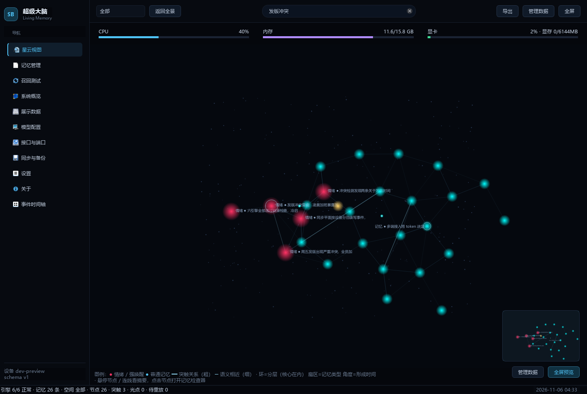
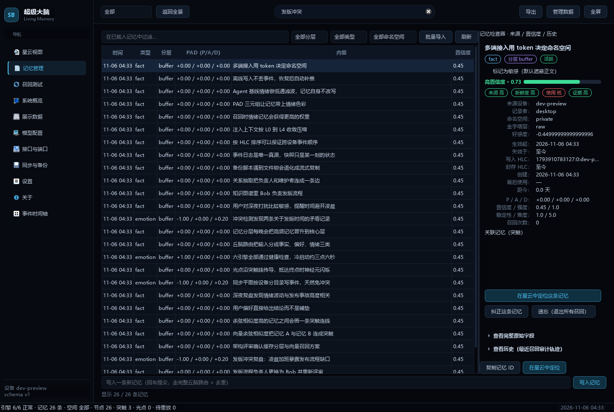
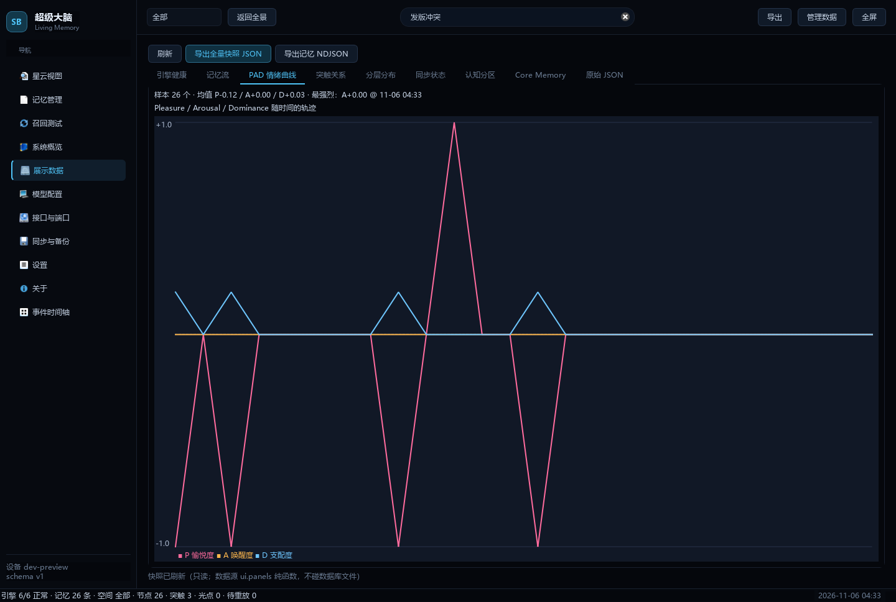
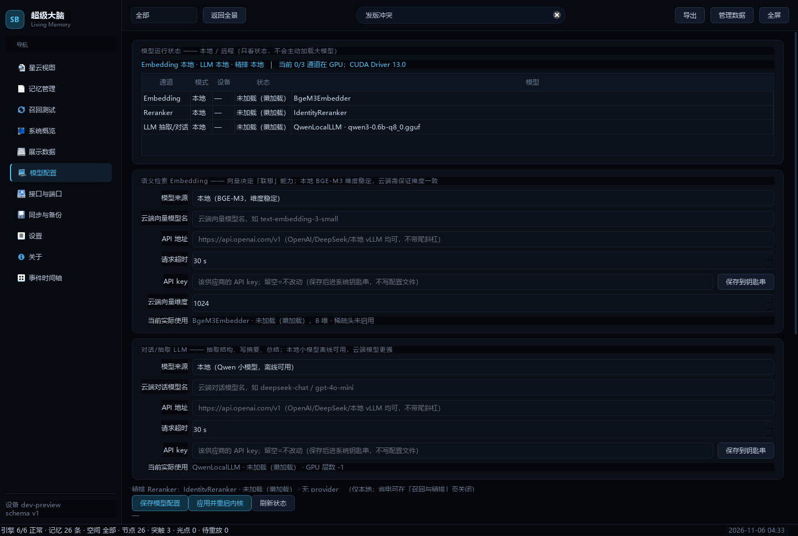
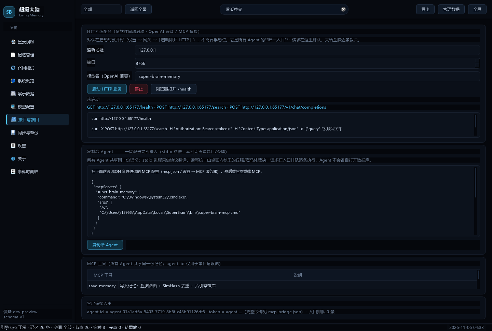
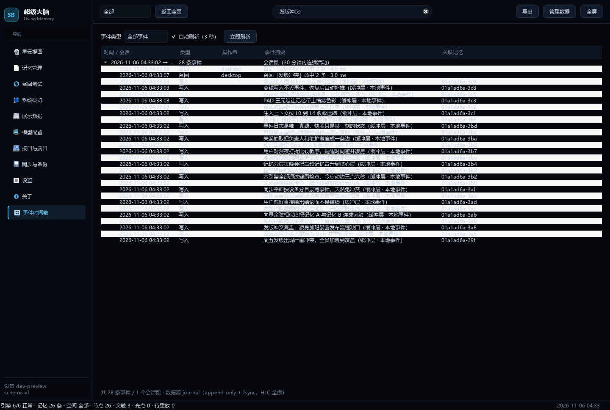
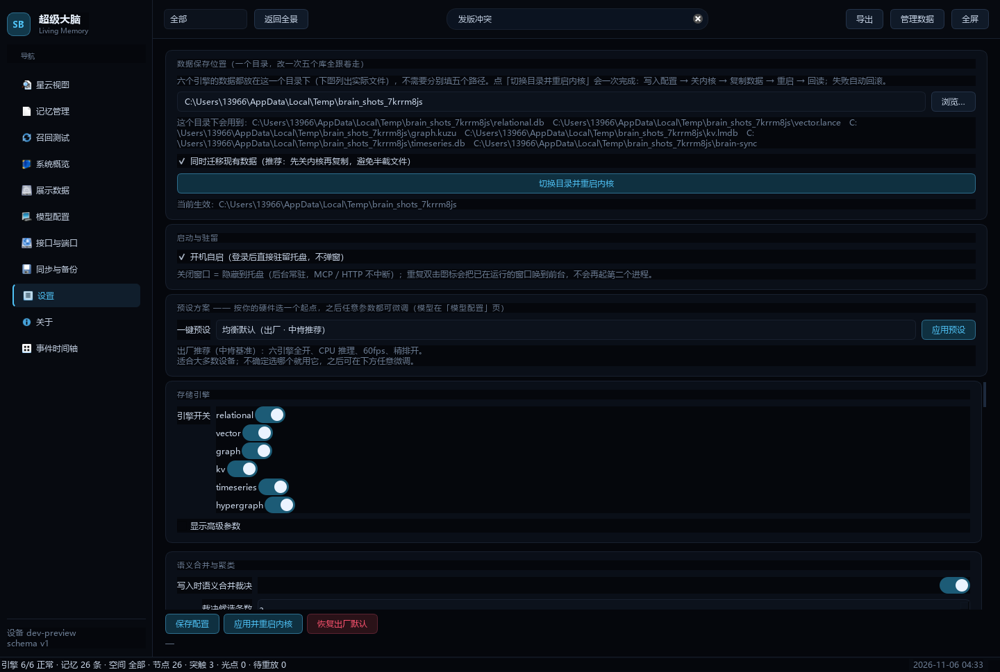

<div align="center">


# 超级大脑 · Super Brain Memory

**给你的所有 AI Agent 装一个共享的外置大脑。**

CodeBuddy / WorkBuddy / DSH / Cursor / Claude Desktop 写进去的记忆，下一秒别的 Agent 就能想起来。

[](https://www.python.org/)
[](https://doc.qt.io/qtforpython/)
[](https://modelcontextprotocol.io/)
[](https://developer.nvidia.com/cuda-toolkit)
[](#-测试)
[](#-license)

[快速开始](#-60-秒接入你的-agent) · [功能](#-它能做什么) · [架构](#-架构) · [截图](#-界面) · [参与贡献](#-参与贡献)

</div>

---

## 🤔 为什么需要它

每个 AI Agent 都有自己的「上下文」，但你的人生只有一个。

- 你跟 CodeBuddy 说过「周五发版要双人复核」，换到 WorkBuddy 它一无所知；
- 你纠正过一条错误记忆，另一个 Agent 还在拿旧版本回答你；
- 云端记忆服务要上传隐私，本地方案又只能给单个应用用。

**超级大脑是一台跑在你自己电脑上的记忆中枢**：所有 Agent 通过 MCP 接进来，读写**同一份**记忆；
写入由「丘脑」统一准入（去重 / 分类 / 情绪标注），再由六引擎投影成可检索的结构，
最后交给本地 BGE-M3 + Qwen 做向量与语义处理。数据不出本机。

<table>
<tr><td width="50%">

**🧠 一个库，所有 Agent 共享**
不是每个 Agent 一份私有笔记。A 写的，B 立刻能召回。

</td><td width="50%">

**🔒 完全本地**
六引擎 + 三模型全在本机，断网可用，记忆不上云。

</td></tr>
<tr><td>

**🔍 可解释的召回**
星云图：环=分层、扇区=类型、角度=时间；点开任意节点看来源、双时态与审计。

</td><td>

**✍️ 可纠正、可遗忘、可审计**
纠正产生新版本并保留原值；遗忘只移出推理路径，审计永远查得到。

</td></tr>
</table>

---

## 🚀 60 秒接入你的 Agent

> 前提：本机已启动超级大脑（桌面端会自动开 `127.0.0.1:8766`），接口页可一键复制下面这段 JSON。

**方式 A：Streamable HTTP（推荐，任何语言的客户端都能用）**

```json
{
  "mcpServers": {
    "super-brain-memory": {
      "type": "streamable-http",
      "url": "http://127.0.0.1:8766/mcp",
      "headers": { "X-Super-Brain-Bridge": "<你的令牌>" }
    }
  }
}
```

**方式 B：stdio（本机进程，无需令牌）**

```json
{
  "mcpServers": {
    "super-brain-memory": {
      "type": "stdio",
      "command": "C:\\Windows\\system32\\cmd.exe",
      "args": ["/c", "%LOCALAPPDATA%\\SuperBrain\\bin\\super-brain-mcp.cmd"]
    }
  }
}
```

令牌在「接口与端口」页显示并可一键复制，**持久化保存，重启不变**。

接好后 Agent 会看到 6 个工具：

| 工具 | 作用 |
|---|---|
| `save_memory` | 写入记忆：自动分类（事实/偏好/情绪/画像）+ SimHash 去重 + 情绪标注 + 六引擎落库 |
| `recall_memory` | 多通道召回：全文 + 向量 + 图谱 + 时间，RRF 融合 + 重排序 |
| `timeline_query` | 按时间窗口查记忆 |
| `profile_read` | 读用户画像槽位 |
| `conflict_report` | 看被推翻/冲突的记忆清单 |
| `health_check` | 六引擎健康检查 |

---

## ✨ 它能做什么

- **外置共享记忆**：多 Agent 并发接入，请求在入口排队，由中枢逐条裁决（Kùzu 单写锁 → 必须统一入口）
- **六引擎存储**：SQLite（关系）/ LanceDB（向量）/ Kùzu（图谱，含超边）/ LMDB（KV）/ DuckDB（时序）/ 事件日志
- **事件溯源**：7 类事件 + HLC 混合逻辑时钟，跨设备重放天然幂等，纠正/遗忘也能重放
- **本地三模型**：BGE-M3（稠密+稀疏）、bge-reranker-v2-m3、Qwen3-0.6B-GGUF，CUDA 加速
- **记忆分层**：buffer → core → recall → archive，FSRS 遗忘曲线驱动强化与归档
- **语义合并**：写入时判断「新增 / 更新 / 合并 / 跳过」，避免记忆库长成一团相似句子
- **夜间巩固**：聚类摘要、升维、冲突检测（可配置调度）
- **可视化控制台**：十一页 PySide6 桌面端，星云图 + 记忆检查器 + 事件时间轴 + 资源仪表
- **Flutter 3D 星云客户端**：纯 Dart 的 Windows 客户端，真 3D 记忆星系（球壳 / 螺旋臂布局，3000+ 节点流畅渲染），WebSocket 实时光脉冲——Agent 写入记忆，星云立刻亮一下
- **v3 事件驱动内核（可选）**：写入 = journal 组提交 + fsync 后立即返回，认知处理由后台 Worker 异步消费；与 v2 并行、随时可回退，另带浏览器版 WebGL 星云
- **无头后端 + 进程分离**：`python -m headless_server` 单进程同时提供 `8766 /mcp`（Agent 接入）、`8768 /v1/*`、`8767 /ws`（Flutter RPC），一份六引擎、一个 Kùzu 写者；Flutter 启动自动探活并拉起它
- **同步**：事件日志走 Git（每设备独立目录，结构上免冲突），另支持快照

---

## 🖥 界面

<div align="center">

**星云视图 —— 环 = 记忆分层（core 在内 / archive 在外），扇区 = 记忆类型，角度 = 形成时间；顶部是 CPU / 内存 / 显卡实时仪表**



</div>

<table>
<tr>
<td width="50%"><br/><sub><b>记忆管理 + 检查器</b>：左侧列表按分层/类型/命名空间过滤，右侧看来源设备、双时态、审计历史与关联突触，一键「纠正 / 封存 / 遗忘」</sub></td>
<td width="50%"><br/><sub><b>展示数据</b>：PAD（愉悦/唤醒/支配）情绪曲线、记忆分层金字塔、认知分区、Core Memory 与原始 JSON</sub></td>
</tr>
<tr>
<td><br/><sub><b>模型配置</b>：三通道（Embedding / Reranker / LLM）× 本地/远程 × 设备 × 状态总览，GPU 是否真的生效一眼可见</sub></td>
<td><br/><sub><b>接口与端口</b>：标准 MCP JSON 一键复制（含持久令牌），所有 Agent 粘上就能用</sub></td>
</tr>
<tr>
<td><br/><sub><b>事件时间轴</b>：journal 全序事件流，按 EventType 筛选，双击直达记忆检查器</sub></td>
<td><br/><sub><b>设置</b>：单一「数据保存位置」一键换盘迁移、开机自启、全量参数表单</sub></td>
</tr>
</table>

---

## 🧩 架构

```
┌──────────────────────────────────────────────────────────────┐
│  Agent 们：CodeBuddy · WorkBuddy · DSH · Cursor · Claude …   │
└───────────────┬───────────────────────────┬──────────────────┘
        MCP stdio│                  MCP HTTP │ /mcp (streamable)
┌───────────────▼───────────────────────────▼──────────────────┐
│  入口队列（FIFO 单工作线程）—— 并发接入，串行裁决            │
├──────────────────────────────────────────────────────────────┤
│  丘脑 Thalamus    准入 · SimHash 去重 · 显著性 · 限流         │
│  海马体 Hippocampus 事件生成 · 冲突消解 · 六引擎分发          │
│  前额叶 Prefrontal  多通道召回 · RRF · 重排序 · 注入          │
│  杏仁核 Amygdala   PAD 情绪 · 好感度基线                      │
│  新皮层 Neocortex   聚类摘要 · 夜间升维                       │
└───────────────┬──────────────────────────────────────────────┘
                │ 事件（fsync 先落盘）
┌───────────────▼──────────────────────────────────────────────┐
│ SQLite │ LanceDB │ Kùzu │ LMDB │ DuckDB │ Journal(NDJSON)    │
└──────────────────────────────────────────────────────────────┘
```

**几条硬约束（踩过坑才定下来的）**

1. **Kùzu 一个库只允许一个写者** → 所有 Agent 必须经入口队列，不能各自开库；
2. **写事件先于写库**（`fsync` 完成才回执），进程被强杀也不丢记忆；
3. **纠正/遗忘不物理删除**：否则落后设备重放 journal 会把记忆「复活」；
4. **索引与缓存是派生数据**：可随时删除重建，结果必须与全扫一致。

**无头后端（推荐的新形态）**：`python -m headless_server` 把上面整张图装进**一个进程**，
同时提供三个入口，Flutter 客户端与所有 Agent 都只是它的客户端：

| 端口 | 入口 | 用途 |
|---|---|---|
| `8766` | `POST /mcp` | 标准 MCP（streamable HTTP），`X-Super-Brain-Bridge` 鉴权；`super-brain-mcp.cmd` 启动器会自动生成 |
| `8768` | `/v1/health` `/v1/events` `/v1/memories` … | v3 HTTP 受理面 + 只读投影 + 浏览器版 WebGL 星云 |
| `8767` | `/ws` | Flutter 的 21+ 个 RPC 方法与 `node_created` / `pulse` 广播 |

MCP 网关与 v3 Worker **共用同一份 `build_app()` 实例**（Kùzu 只允许一个写者），
v3 只读投影取 `config.storage.sqlite_path`，与 v2 主库天然是同一份数据。
Flutter 启动时先探活 `/v1/health`，没起来才拉起后端独立进程；Qt 前端目前保留作对照，
待 Flutter 真机验收后再删除（见 [`flutter_app/README.md`](flutter_app/README.md)）。

---

## 📦 安装

### A. 一体安装包（推荐：Flutter 前端 + 随包部署的后端）

一个安装包、**两个进程**：双击 `super_brain.exe`（Flutter 原生窗口），它会探活并自动拉起
`backend\headless-server.exe`——冻结的 Python 后端，无 GUI、无 Qt，目标机器不需要装 Python /
PySide6 / 任何依赖。Python 解释器不能塞进 Flutter 的 exe 内部，所以采用「随安装包一起部署」。

```powershell
# 构建（没有 Flutter SDK 就加 -InstallSdk，会自动 clone stable 到 D:\flutter）
powershell -ExecutionPolicy Bypass -File scripts\build_full_release.ps1 -InstallSdk -Launch
```

Qt 桌面端约 7,000 行 / 630 KB 源码，但独占 `PySide6-Essentials` 200–300 MB；`--headless`
构建模板已把它排除，发行包里不会带上。Qt 仅保留为隐藏调试入口 `python -m ui.desktop`
（与后端互斥，Kùzu 单写者），默认完全不加载。详见 [`flutter_app/README.md`](flutter_app/README.md)。

### B. 旧版 Qt 桌面便携包（调试 / 对照）

1. 到 [Releases](../../releases) 下载分卷压缩包（每卷 < 2GB），全部下载后放到同一目录；
2. 双击 `reassemble.cmd` 合并解压（或手动 `copy /b part1+part2+... super-brain.zip`）；
3. 运行 `super-brain.exe`，数据自动落到 `%APPDATA%\super-brain\data`。

> 发行包不含 3.3GB 模型权重（太大），首次启动会走降级路径（字符 n-gram + 规则抽取），
> 功能可用但语义检索变弱。想要满血 GPU：把 BGE-M3 / bge-reranker ONNX 与 Qwen3-0.6B GGUF
> 按 `data/models/` 的结构放进 `_internal\models\`，再跑 `super-brain-cli.exe --probe-models --json`
> 看到 `"verdict": "GPU_OK"` 即成功。

### C. 从源码跑（开发者）

```powershell
git clone https://github.com/FFGG10-29/super-brain-memory
cd super-brain-memory
python -m venv .venv
.\.venv\Scripts\python.exe -m pip install -r requirements.txt
# 可选：GPU 加速（onnxruntime-gpu / llama-cpp-python CUDA 轮子）
.\.venv\Scripts\python.exe -m pip install -r requirements-optional.txt
.\.venv\Scripts\python.exe -m ui.desktop          # Qt 桌面端（验收期保留）
.\.venv\Scripts\python.exe -m headless_server      # 无头后端：MCP 8766 + HTTP 8768 + WS 8767
.\.venv\Scripts\python.exe scripts\verify_headless.py   # 端到端验收（临时目录隔离）
.\.venv\Scripts\python.exe -m pytest tests -q     # 跑测试（141 passed）
```

Flutter 客户端（会自动拉起无头后端，需要 Flutter SDK）：

```powershell
powershell -ExecutionPolicy Bypass -File flutter_app\scripts\run_windows.ps1
```

GPU 验证（最权威的一条）：

```powershell
.\.venv\Scripts\python.exe main.py --probe-models --json
# 期望："verdict": "GPU_OK", "all_on_gpu": true, "embedder": {"sparse_enabled": true}
```

---

## 🗺 路线图

- [x] 六引擎 + 事件溯源 + 同步
- [x] 记忆可视化（星云 / 时间轴 / 检查器 / Core Memory）
- [x] 用户控制闭环（纠正 / 封存 / 遗忘 + 审计）
- [x] 多 Agent 共享 + 标准 MCP over HTTP + 持久令牌
- [x] v3 事件驱动内核（journal 组提交 + 租约收件箱 + 守护进程/Worker）+ Flutter 3D 星云客户端
- [x] 无头后端单进程统一内核 + Flutter 十四页功能补齐 + 后端自动拉起
- [ ] Flutter 真机验收（analyze / build windows）通过后删除 Qt 前端 `ui/desktop/`
- [ ] 记忆图谱自动补全与关系推理（LLM 抽三元组已就绪，待更强模型）
- [ ] 跨设备增量同步可视化（落后游标 / 冲突预览）
- [ ] Linux / macOS 发行包
- [ ] 插件市场：Obsidian / VSCode / 浏览器剪藏

---

## 🤝 参与贡献

这个项目**非常欢迎一起完善**——尤其是下面这些我一个人的机器验证不了的事：

- **换机实测**：你的显卡 / 驱动组合下 `--probe-models` 是否 `GPU_OK`
- **新 Agent 接入**：把你用的客户端配置贴到 Discussions，我补进文档
- **十万级压测**：召回 P95、索引重建耗时、内存占用
- **UI / 交互**：星云布局、检查器信息密度、暗色配色

提交前请保证：

```powershell
.\.venv\Scripts\python.exe -m pytest tests -q     # 必须全绿
```

设计取舍与踩坑记录都在 [`.memory/`](.memory/)（ADR、验收台账、工作记忆），
改代码前先读 `WORKING_MEMORY.md` 的「已知坑」，能省你半天。

---

## 🧪 测试

```
141 passed  # 六引擎 / 事件重放 / 召回质量 / 用户控制 / MCP 双通道 / 配置中心
```

CI 尚未接入（本机 Windows + CUDA），欢迎帮忙加 GitHub Actions 的 CPU-only 流水线。

---

## ⭐ Star 一下

如果这个项目让你少装了十个「AI 记忆插件」，点个 **Star** 就是最好的支持——
它也能让更多被「每个 Agent 各记各的」折磨的人找到这里。

<div align="center">

**Built with 🧠 on Windows + CUDA · 数据永远在你自己手里**

</div>

---

## 📄 License

MIT（见 [LICENSE](LICENSE)）。模型权重遵循各自上游许可（BAAI/bge-m3、BAAI/bge-reranker-v2-m3、Qwen）。
