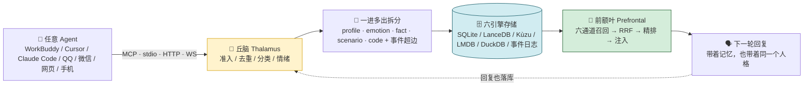
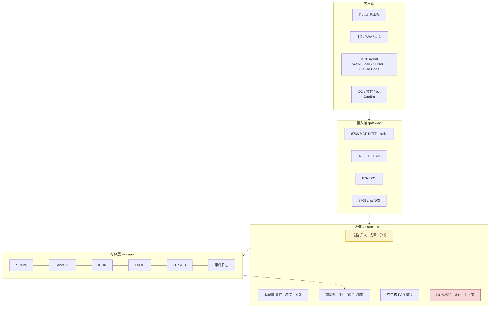

<div align="center">

# 🧠 超级大脑 · Super Brain Memory

**一台跑在你自己电脑上的长期记忆中枢 —— 让所有 AI 工具共享同一份记忆，还附赠一个会自己换头像、写日记、发说说的人格。**

[](LICENSE)
[](https://www.python.org/)
[](https://flutter.dev/)
[](https://modelcontextprotocol.io/)
[](https://github.com/FFGG10-29/super-brain-memory/releases)
[](#-隐私与数据边界)

<br/>

| 🌌 记忆星云 | 🔍 可解释召回 | 🎭 人格设定 |
|:---:|:---:|:---:|
|  |  |  |
| 上千条记忆铺成真 3D 星云，写入与召回会亮起光脉冲 | 六通道命中数、融合权重、最终注入正文全都能看见 | PAD 情绪坐标 + 人格参数滑块 + 版本回滚 |

</div>

---

## 目录

- [🤔 为什么需要它](#-为什么需要它)
- [⚡ 30 秒看懂](#-30-秒看懂)
- [✨ 它能做什么](#-它能做什么)
- [🧬 记忆是怎么工作的](#-记忆是怎么工作的)
- [🎭 L0 人格层：全渠道唯一真源](#-l0-人格层全渠道唯一真源)
- [🔌 全渠道接入](#-全渠道接入)
- [🖥 桌面端](#-桌面端)
- [📱 手机端 PWA](#-手机端-pwa)
- [🌱 AI 空间与主动行为](#-ai-空间与主动行为)
- [☁️ 模型层：云端嵌入 + 号池路由](#️-模型层云端嵌入--号池路由)
- [📦 安装](#-安装)
- [🏗 架构与目录](#-架构与目录)
- [🛠 构建与打包](#-构建与打包)
- [🔒 隐私与数据边界](#-隐私与数据边界)
- [🗺 路线图与已知边界](#-路线图与已知边界)
- [🧪 测试 · 贡献 · License](#-测试--贡献--license)

---

## 🤔 为什么需要它

你同时用着好几个 AI 工具：IDE 里的编程助手、桌面 Agent、聊天机器人、手机上的网页版。它们各有各的「记忆」，于是：

- 在 A 里讲过的项目背景，到 B 里要**从头再说一遍**；
- A 记住了你喜欢简洁回答，B 还在给你写八股文；
- 同一个人的偏好散落在五个地方，**互相矛盾、越用越乱**；
- 更糟的是，你根本不知道它「记住」了什么、为什么这轮突然想起那句话。

超级大脑把这件事反过来做：**记忆不属于任何一个 Agent，而是一台独立的本地服务**。所有工具通过标准 MCP 读写同一份记忆，写入统一准入、召回统一排序、人格统一来源。

| | 没有记忆中枢 | 有了超级大脑 |
|---|---|---|
| 跨工具上下文 | 每个 Agent 一份私有笔记 | A 写完，B 立刻能召回 |
| 人格一致性 | 每个渠道一套提示词，越改越飘 | **L0 唯一真源**，QQ / 微信 / 网页 / 手机同一种人 |
| 召回可信度 | 黑盒，答错了不知道为什么 | 六通道命中数 + RRF 权重 + 注入正文**全可解释** |
| 情绪与偏好 | 一句「用户喜欢简洁」 | PAD 三维认知坐标 + 分层记忆 + 主题标签 |
| 数据归属 | 躺在各家云端 | **记忆正文只在本机**，六引擎全本地落盘 |
| 可视化 | 无 | 真 3D 星云、时间线、图谱、PAD 分布 |

> 一句话：**它不是又一个聊天机器人，而是给所有聊天机器人装同一块海马体。**

---

## ⚡ 30 秒看懂



**四个刻在架构里的铁律：**

1. **事件先于落库** —— `fsync` 完成才回执，进程被强杀也不丢记忆；
2. **纠正 / 遗忘不物理删除** —— 否则落后设备重放日志会把记忆「复活」；
3. **索引与缓存都是派生数据** —— 随时可删可重建，结果必须与全扫一致；
4. **一进多出，无例外** —— 任何途径写记忆（聊天 / MCP / stdio / OneBot / 蒸馏 / 导入）都必须先拆成一组结构化记忆再整组入池；抽取失败就留待重试，**绝不降级成单条 neuron 混进记忆库**。

---

## ✨ 它能做什么

| 能力 | 说明 |
|---|---|
| 🧠 **六引擎存储** | SQLite 关系 / LanceDB 向量 / Kùzu 图谱（含超边）/ LMDB KV / DuckDB 时序 / 事件日志，各司其职又互为冗余 |
| 🔎 **六通道可解释召回** | FTS 全文 · 稠密向量 · 稀疏向量 · 图谱关联 · 时序习惯 · 情绪权重，RRF 融合后可精排；每轮都返回命中数与权重 |
| 🧬 **认知契约** | 每条记忆带 `memory_type / PAD 情绪 / confidence / entities / relations`，还有 `topic · layer · source · category · sensitive` 分层标注 |
| 🎭 **L0 人格层** | 唯一真源，跨 QQ / 微信 / bot / 网页 / 手机一致；参数可滑块微调、版本可回滚、可正负反馈提案 |
| 🌌 **真 3D 星云** | 语义成团、按类型着色、写入召回亮脉冲；可切 2D 语义环、时间线、图谱投影 |
| 🔌 **标准 MCP** | **66 个工具 + 6 个 resources**，stdio / streamable HTTP 双通道，一张 `tool_catalog.py` 表统一维护，新增能力三通道自动同步 |
| 📱 **QQ 风手机端** | PWA 全屏 IM：聊天记录持久化、表情包、语音、图片、资料卡、Q空间、QQ 日记、AI 主动找你聊 |
| 🌱 **AI 空间** | AI 自己换头像、写签名、发说说、写日记，配图由它自己定场景与文案，全部本地持久化 |
| 🎛 **号池与模型路由** | 多账号 / 多模型统一登记，按角色（extract / rerank / chat …）分流，支持免费额度策略 |
| 🖥 **桌面端** | Flutter 纯 Dart 实现，无窗后端、托盘常驻、关窗隐藏、断连自动亮窗、系统资源仪表 |
| 📦 **一键安装包** | 前后端打进同一个 Windows Setup，约 260 MB，装完前端自动拉起后端 |
| 🔒 **本地优先** | 记忆正文、人格档案、聊天记录全在本机；密钥存系统钥匙串，不写进代码或仓库 |

---

## 🧬 记忆是怎么工作的

### 写入：丘脑统一准入

所有写入都先过 `brain/thalamus.py`：SimHash 去重、类型分类、情绪标注、按 Agent 限速（`default_rate_limit`），然后由 `brain/hippocampus.py` 生成事件并分发到六引擎。

**认知契约（Cognition Contract）** 是写入时随正文一起提交的元数据包，由当前会话的对话模型判定，不交给本地小模型瞎猜：

```json
{
  "content": "主人偏好：回复要短、结论先行、用表格对比",
  "cognition": {
    "memory_type": "profile",
    "pad": { "p": 0.2, "a": 0.4, "d": 0.7 },
    "confidence": 0.92,
    "entities": [{ "name": "回复风格", "type": "preference" }],
    "relations": [{ "subject": "主人", "predicate": "偏好", "object": "结构化简短回复" }],
    "topic": "<SPACE_ID>",
    "layer": "fact",
    "source": "workbuddy"
  }
}
```

- **PAD**：`p` 愉悦度 / `a` 唤醒度 / `d` 支配度，各 `[-1, 1]`，用户情绪优先反映到 `p/a`；
- **layer**：`persona | fact | episode`，persona 层写入需显式授权；
- **topic**：记忆空间的 id，是**主题标签而不是隔离容器** —— WorkBuddy 按类过滤，bot 默认全量可读；
- **source**：数据通道（`workbuddy / bot / import / manual`），与「认知判定者」分开记。

宿主侧还有一层 **Guard 兜底**：拦截写入、校验并补写低置信 / 零 PAD，产出 MemoryReceipt 回执。即便某个客户端忘了带认知包、后端是旧版，落库的记忆也一定带 PAD。

### 召回：六通道 + RRF，且全程可解释

`brain/prefrontal.py` 把六种信号融合成最终注入正文：

| 通道 | 擅长 |
|---|---|
| FTS 全文 / 2-gram | 精确词、专有名词、代码符号，**毫秒级**快路径 |
| 稠密向量 | 语义相近但用词不同 |
| 稀疏向量 | 关键词权重与长尾词 |
| 图谱关联 | 人、事、物之间的超边关系 |
| 时序 / 习惯 | 最近发生、反复出现的模式 |
| 情绪 / PAD | 当下语境与情绪状态匹配的记忆 |

`recall_memory` 默认走只读投影快路径；`deep=true` 才启用六通道精排，返回值带 `recall_mode` 说明这轮走了哪条路。桌面端「召回测试」页会把**每通道命中数、RRF 权重、字数/情绪/习惯加权、最终注入正文**逐项摊开给你看 —— 答得不对，一眼能查到是哪条记忆、被哪个通道捞上来的。

### 记忆的其它面

- **时间线 / 快照 / 冲突报告**：`timeline_query`、`create_snapshot`、`conflict_report`，记忆有历史、可回溯；
- **空间与主题**：`spaces_*` 管理记忆空间，`topics_*` 做主题迁移，同一份记忆可跨主题保留关联边；
- **纠正与遗忘**：`memory_correct` / `memory_forget`（先 seal 再 tombstone），不做物理删除；
- **技能演化**：`skills_*` 让记忆沉淀成可复用的能力描述；
- **同步**：`sync/` 的 journal + git worker + snapshot，多设备最终一致。

---

## 🎭 L0 人格层：全渠道唯一真源

人格不是散落在各处提示词里的几句话，而是一套**有版本、有参数、有回滚、全渠道共用**的 L0 层。

- **骨架只读**：项目档案里的 L0 文档定义「是谁、怎么说话、怎么认主人」，改动有备份、有 revision；
- **参数主存**：`persona.json` 存可调参数，桌面端「记忆洞察 → 人格设定」有滑块与版本回滚；
- **实时注入**：ChatEngine 每轮把 L0 组装进 prompt，QQ / 微信 / 网页 / 手机**永远读到同一份**，过时人格副本一律清理；
- **主人识别**：通过主人专属令牌连进来的网页 / 手机端就是主人本人，不需要报身份或 QQ 号。

| 参数 | 含义 | 默认 |
|---|---|---|
| `sassiness` | 斗嘴强度 | 0.6 |
| `clinginess` | 黏人程度 | 0.6 |
| `jealousy` | 吃醋阈值 | 0.5 |
| `care_initiative` | 主动关心触发 | 0.5 |
| `sleep_nag` | 深夜催睡 | 开 |
| `signature_auto` | 被夸 / 受委屈 / 生日自动改签名 | 开 |
| `command_channel` | 闲聊 / 指令双通道，主人指令不装傻 | 开 |
| `max_lines_per_reply` | **最大回复条数（硬上限）** | 6 |

> **`max_lines_per_reply` 是上限，不是每轮目标。** 设 3 → 按语境回 1~3 条，设 5 → 回 1~5 条，绝大多数时候少于上限，绝不每轮都发满、也绝不把一句话硬拆成几行凑数。条数由这轮语境和情绪自然决定。

配套还有「情绪基线」「正负反馈提案」「人格参数审计」，以及 L0 文档改动后**立即生效**的缓存失效机制（骨架缓存绑定文件 mtime，不再需要重启后端）。

---

## 🔌 全渠道接入

### 端口与入口

| 端口 | 入口 | 用途 |
|---|---|---|
| `8766` | `POST /mcp` | 标准 MCP（streamable HTTP），桥接鉴权；**66 工具 + 6 resources** |
| `8768` | `/v1/health` `/v1/events` `/v1/rpc` … | v3 HTTP 受理面、只读投影、浏览器版星云 |
| `8767` | `/ws` | Flutter 的 WS RPC（`graph` / `graph.chunk` / `recall` / `memories` …）与 `node_created` / `pulse` 广播 |
| `8769` | chat WebSocket | 纯消息流聊天通道，`hello` 帧用**聊天专用令牌**；默认只绑 `127.0.0.1` |

> 无头后端 `headless_server` 把上述入口装进**一个进程**；桌面前端启动先探活，没起来才拉起后端。手机端走自己的反向代理 + WebSocket 转发，不直接暴露这些端口。

### MCP 一行接入

把下面这段粘到任意支持 MCP 的 Agent 配置里（令牌从本机 `%APPDATA%\super-brain\` 下的桥接配置取，**不要写进仓库**）：

```json
{
  "mcpServers": {
    "super-brain": {
      "url": "http://127.0.0.1:8766/mcp",
      "headers": { "X-Super-Brain-Bridge": "<YOUR_BRIDGE_TOKEN>" }
    }
  }
}
```

stdio 通道同样可用，适合本地 CLI Agent。新增能力只需改 `gateway/tool_catalog.py` 一张表，MCP / HTTP / stdio 三条通道自动同步。

### 66 个工具，按用途分

| 组 | 代表工具 |
|---|---|
| 记忆读写 | `save_memory` `recall_memory` `recall_deep` `memory_list` `memory_inspect` `memory_correct` `memory_forget` `memory_reclassify` `memory_sensitive` `memory_audit` |
| 人格 | `persona_get` `persona_set_params` `persona_baseline` `persona_proposals` `persona_feedback` `persona_rollback` `persona_apply_proposal` |
| 空间 / 主题 | `spaces_list` `spaces_create` `spaces_activate` `spaces_update` `topics_list` `topics_migrate` |
| 上下文 / 文档 | `context_compose` `context_manifest` `context_status` `documents_list` `documents_read` `documents_search` `documents_mutate` |
| 图谱 / 可视化 | `graph_projection` `graph_real_edges` `activation_graph` `pad_distribution` |
| 运行时 | `health_check` `engine_status` `system_stats` `model_status` `gateway_status` `data_status` `runtime_get` `runtime_mutate` `sync_once` |
| 会话 / 时间线 | `timeline_query` `create_snapshot` `conflict_report` `import_memories` `data_migrate` |
| 技能 / 托盘 | `skills_list` `skills_get` `skills_upsert` `skills_evolve` `skills_delete` `tray_status` `tray_enable` `tray_disable` |
| 测试 / 审计 | `verify_reconstruction` `evaluate_reconstruction_coverage` `secrets_status` `config_presets` `config_apply_preset` |

另有 6 个 resources 可直接挂进 Agent 上下文（运行图、回合视图、回执、认知审计等）。

---

## 🖥 桌面端

Flutter 纯 Dart 实现，零重量级图表依赖 —— `brain_client.dart` 统一 WS RPC 并断线降级 HTTP，`graph_model.dart` 做语义聚类与布局，`nebula_painter.dart` 用 `drawPoints` 批量绘制星点、云气、连线与脉冲。首屏取数带重试，**不会把「连接被拒」误画成「0 节点」**。

| 页面 | 你能做的事 |
|---|---|
| 🌌 记忆星云 | 3D 旋转 / 缩放、按类型着色、写入召回光脉冲、点选记忆读全文 |
| 🔍 召回测试 | 输入一句话，看六通道命中数、融合权重与最终注入正文 |
| 🎭 人格设定 | L0 骨架只读展示、参数滑块、版本回滚、正负反馈提案 |
| 📊 PAD 认知分布 | 愉悦度 × 唤醒度散点，按类型 / 分层统计均值 |
| 💬 大肥鱼聊天 | 直连 8769，自动召回注入、回复落库、会话持久化 |
| 🌱 AI 空间 | 说说 / 日记 / 相册，AI 自主产出的内容与配图 |
| 🎛 账号号池 | 多账号多模型登记、角色路由、免费额度策略 |
| 🗃 缓存与引擎 | 缓存命中指标、引擎健康、索引重建开关 |
| ⚙️ 全量配置 | 分组参数、中文化说明、MCP 配置一键复制 |
| 📈 系统监控 | CPU / 内存 / 显卡 / 磁盘仪表、运行日志 |

**进程与窗口细节**：后端无控制台窗口（`pythonw` / `console=False` 双保险）、关窗默认隐藏到托盘、事件流断开自动亮窗、托盘图标随后端连接注册。这些都是为了让它在后台安静待着，不打扰你。

<div align="center">


</div>

---

## 📱 手机端 PWA

不用装 App、不用企业证书：**Safari / Chrome 打开网页 → 分享 → 添加到主屏幕**，就是一个全屏 IM。

| 模块 | 能力 |
|---|---|
| 💬 聊天 | 每行独立气泡、聊天记录 IndexedDB 持久化（400 条）、导出 / 导入 JSON、静默重连、顶部状态条 |
| 😊 表情 | 左侧语音按钮 / 右侧表情入口；QQ 表情、**图片表情包**（可下载 / 收藏 / 本地导入）、我的收藏三栏 |
| 🖼 图片 | ＋面板选本地图片或拍照 → canvas 压缩 → 走 `message.images` 真发后端多模态；AI 回复里的图片链接自动渲染 |
| 🎙 语音 | 按住录音、语音气泡点击播放、浏览器语音识别转文字、回复可 TTS 朗读 |
| 👤 资料卡 | 点头像弹资料卡 → Q空间 / QQ 日记 / 聊天相册 / 详细资料，头像签名可改、也能让 AI 自己改 |
| 🌱 主动行为 | 前端计时触发 AI 主动开口，AI 定时自己换头像、写签名、发说说、写日记并自己配图 |
| 📐 移动端适配 | `visualViewport` 锁容器，键盘弹出**只压缩消息区**；顶部安全距可调，避开灵动岛 |

**部署**：静态文件挂任意 HTTPS 站点，用 nginx 把 `/sb/ws` 反代到 chat WebSocket、`/sb/api/` 反代到 HTTP，本机用 SSH 反向隧道把端口转发出去即可。聊天令牌只存手机 localStorage，页面里不硬编码。

> ⚠️ 手机端依赖家里那台 Windows 上的桌面端 / 后端在运行；它不是独立云服务。

---

## 🌱 AI 空间与主动行为

v3.1.0 里最好玩的一块：**空间说说、日记、头像、签名、配图全部由 AI 自己生成，不需要主人点、也不需要主人填。**

- 连接成功后自动跑一轮全套，之后按间隔（可调）持续自主；
- AI 自己决定此刻心情、签名文案、头像配色 / 贴纸、说说与日记正文、配图场景（夜空 / 海底 / 雨天 / 午后 / 摸鱼 / 暖调）与配图短句；
- 所有产物 —— 资料（含 AI 自绘头像）、说说、日记、配图、头像历史、动作记录、聊天记录、表情包 —— 全部存本机 IndexedDB，杀掉重开不丢，可一键导出全量备份；
- 说说 / 日记正文静默同步进超级大脑 AI 空间；
- 有**内容质量闸门**：元话术（"好的，正在生成…"）、过短文本、重复文案一律拦下不发布；也有去重、节流与开机自动清理历史垃圾动态。

---

## ☁️ 模型层：云端嵌入 + 号池路由

v3.1.0 做了一次大瘦身：**本地模型权重全删**（bge-m3 / reranker / Qwen3 GGUF 与 CUDA 运行时一并裁撤），稠密/稀疏嵌入与交叉编码精排改走任意 OpenAI 兼容的远端 API。

带来的直接好处：

- 安装包从 **6.4 GB → 约 260 MB**，不再需要显卡、不再下载几个 G 的权重；
- 密钥存**系统钥匙串 / 凭据管理器**（或环境变量），不写进代码、不写进仓库；
- `gateway/account_pool` + `gateway/model_router` 统一管理多账号多模型，按 `extract / rerank / chat` 等角色分流；
- 配置由 `core/user_config.py` 的差异补丁加载，前端改完即生效；`config_apply_preset` 提供低配 / 均衡 / 高质量三档预设。

> 代价如实说：嵌入与重排请求会离开本机（只发文本片段到你配置的服务），**记忆正文与人格档案从不上传**。完全离线的本地模式需要自行重新接入本地推理运行时。

---

## 📦 安装

### A. Windows 一体安装包（推荐）

去 [Releases](https://github.com/FFGG10-29/super-brain-memory/releases) 下载 `Super-Brain-3.1.0-setup.exe`（约 260 MB）：

- 前端 `super_brain.exe` + 后端 `backend\headless-server.exe` **打进同一个安装包**，装完在同一目录；
- 默认装到 `D:\SuperBrain`，AppId / 名称 / 版本 / 图标与旧版一致，**升级覆盖安装不会变成两个软件**；
- 后端无控制台黑窗；**启动前端 → 前端自动拉起后端**，不需要手动跑命令；
- 记忆数据落在 `%APPDATA%\super-brain\data`，安装包**不含任何记忆或人格数据**。

首次启动后在「全量配置 → 模型」里填好嵌入 / 重排服务的 base_url 与密钥（存钥匙串），即可开始写记忆。

### B. 从源码跑（开发者）

```bash
git clone https://github.com/FFGG10-29/super-brain-memory.git
cd super-brain-memory
python -m venv .venv
.venv\Scripts\pip install -r requirements.txt

# 启动无头后端：MCP + HTTP + WS + chat 全在一个进程
.venv\Scripts\python -m headless_server --no-circadian

# 另开一个终端跑桌面端
cd flutter_app
flutter pub get
flutter run -d windows
```

可选依赖见 `requirements-optional.txt`。GPU / 本地推理运行时不再是必需项。

### C. 验证

```bash
curl http://127.0.0.1:8768/v1/health
```

或在桌面端「召回测试」页随便写一条记忆、再搜一次，看到六通道命中数就说明链路通了。

---

## 🏗 架构与目录



| 目录 | 职责 |
|---|---|
| `brain/` | 丘脑、海马体、前额叶、新皮层、记忆服务、云模型适配、准入守卫 |
| `core/` | 人格层、上下文分层、缓存管理、快速召回、运行时路径、用户配置、系统能力 |
| `gateway/` | MCP stdio / HTTP、工具清单、RPC 映射、号池、模型路由、桥接 |
| `v3/` | RPC 受理面、扩展方法、守护进程、Worker |
| `chat/` | 8769 聊天引擎、协议帧、会话注册表（聊天记录落 `sessions.db`） |
| `storage/` | 六引擎具体存储实现 |
| `engine/` | 嵌入、重排、本地 LLM 适配、CUDA 运行时探测（云端化后为可选） |
| `workers/` `sync/` | 生命周期循环、昼夜节律、journal 同步与快照 |
| `flutter_app/` | Windows 桌面端（纯 Dart） |
| `mobile_pwa/` | 手机端 PWA 静态页与本体头像 |
| `scripts/` | 构建、部署、迁移、清洗、验证工具 |
| `tests/` | 覆盖率较高的单元与端到端测试 |
| `docs/` | 发布说明、截图、设计文档 |

---

## 🛠 构建与打包

```bash
# 1) 前端
cd flutter_app
flutter build windows --release

# 2) 后端（精简 frozen onedir，排除本地推理运行时）
cd ..
.venv\Scripts\python -m PyInstaller super-brain-backend-lite.spec --noconfirm

# 3) 安装包（Inno Setup 6）
ISCC.exe flutter_app\superbrain_setup.iss
```

要点：

- `super-brain-backend-lite.spec` 从源头 `excludes` 掉 onnxruntime / llama_cpp / CUDA 相关依赖，产物约 735 MB（压缩进包约 260 MB）；项目里这些 import 都是函数内懒加载且带兜底，`scripts/test_lite_backend.py` 专门验证精简包可启动；
- `headless-server.exe` 用 `console=False`，前端拉起时不会有黑窗；`-cli.exe` 是排障用的控制台版；
- `superbrain_setup.iss` 固定 AppId / 名称 / 版本 / 安装目录，并排除模型运行时与备份文件；
- 旧版 `scripts/installer/setup.iss` 是历史全量包脚本（含分卷与模型），保留供参考，新发布统一用精简脚本。

---

## 🔒 隐私与数据边界

这一节请认真看，也是这个项目的底线。

| 内容 | 在哪 | 会不会离开本机 / 进仓库 |
|---|---|---|
| 记忆正文、人格骨架、聊天记录、说说日记配图 | 本机数据目录（frozen 态 `%APPDATA%\super-brain\data`） | ❌ 不上传、❌ 不随安装包分发、❌ **不入库** |
| 六引擎落盘文件（`.db` / `.lance` / `.kuzu` / `.lmdb`） | 本机数据目录 | ❌ `.gitignore` 明确忽略 |
| 工作记忆 / 私人档案 `.memory/` | 本机 | ❌ `.gitignore` 明确忽略，历史里曾跟踪的文件已撤下 |
| 构建日志、备份文件、本机用户名路径 | 本机 | ❌ `*.log` / `*.bak*` 全部忽略 |
| 桥接令牌、聊天令牌、API 密钥、SSH 私钥 | 本机凭据管理器 / 钥匙串 / 手机 localStorage | ❌ 不写进代码、不写进文档、不入库 |
| 嵌入 / 重排请求 | 你配置的 OpenAI 兼容服务 | ⚠️ 只发文本片段，密钥由钥匙串提供 |
| 安装包 | GitHub Release | ✅ 只含程序文件，**不含任何记忆或人格数据** |

**给贡献者**：提交前请确认没有把 `.env`、`config.json`、`flutter_prefs.json`、`chat_token.txt`、`*.db`、`*.log`、备份文件或任何真实令牌加进暂存区。配置示例一律用 `<YOUR_TOKEN>` / `<YOUR_API_KEY>` 占位。手机端部署文档里的域名与端口请替换成你自己的，不要提交真实服务器地址。

> 记忆是你的，不是仓库的。

---

## 🗺 路线图与已知边界

**已落地**：六引擎 + 事件溯源 + 同步 · 多 Agent 共享与标准 MCP · 66 工具 / 6 resources 单一真源 · 认知契约与 PAD · L0 人格层 · 3D 星云与可解释召回 · 云端嵌入 / 重排 · 号池与模型路由 · 8769 聊天通道 · QQ 风手机 PWA · AI 自主空间 · 前后端合一 Windows 安装包。

**已知边界（如实说）**：

- 手机端「收服务端生成图」目前推的是 Windows 本机路径，手机无法预览；要真收图需后端改推 URL / data URL；
- AI 主动聊天由前端计时触发，不是后端常驻任务主动推送；
- 语音识别依赖浏览器 `SpeechRecognition`，不支持的浏览器按 `[语音消息]` 占位发送；
- AI 说说配图是「AI 决定场景 / 配色 / 文案 / 贴纸 + 前端 canvas 合成」，不是 diffusion 级生图（后端暂无生图 API）；
- 手机端依赖家里 Windows 端在线；PWA 是直连超级大脑的独立前端，不是 AstrBot 客户端，但人格同为 L0 唯一真源；
- 完全离线模式需要自行重新接入本地嵌入 / 重排运行时。

**下一步**：服务端图片事件改推 URL · 后端常驻主动推送 · 服务端 ASR/TTS · 更多 Agent 适配与人格同步自动化。

---

## 🧪 测试 · 贡献 · License

```bash
.venv\Scripts\python -m pytest -q
```

`tests/` 覆盖丘脑准入、一进多出、云模型回退、号池、MCP stdio、增量记忆、聊天引擎等；`scripts/test_lite_backend.py` 单独验证精简 frozen 包在缺少本地推理运行时下能否启动。

欢迎 Issue / PR，尤其是：新的 MCP 工具、更多 Agent 接入、召回质量评估、移动端体验。提交前请跑一遍测试，并**再读一次上面的隐私边界**。

<div align="center">

如果它替你记住了点什么，给个 ⭐ 吧 —— 记忆会替你记着这件事。

[MIT License](LICENSE) © 2026 FFGG10-29

</div>
